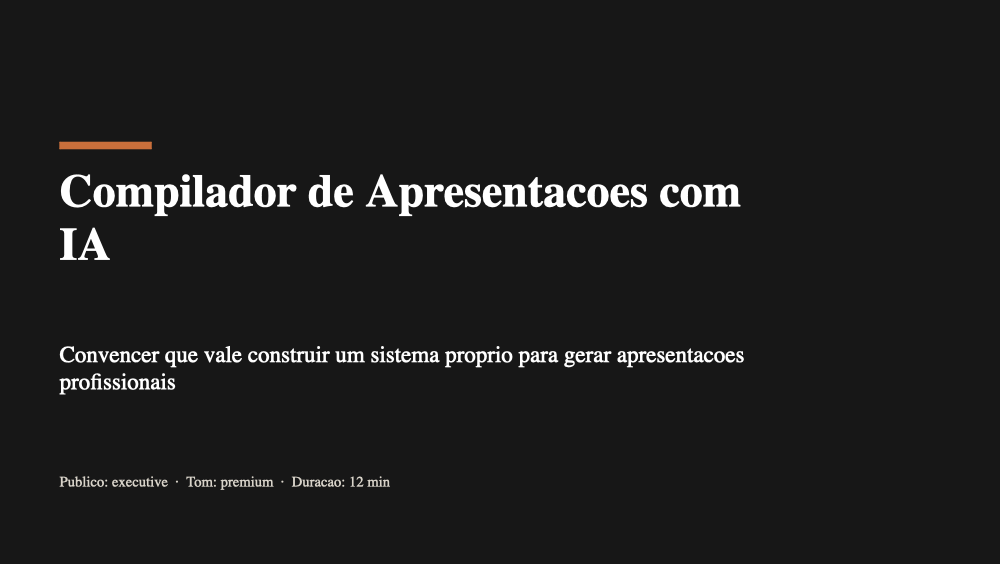
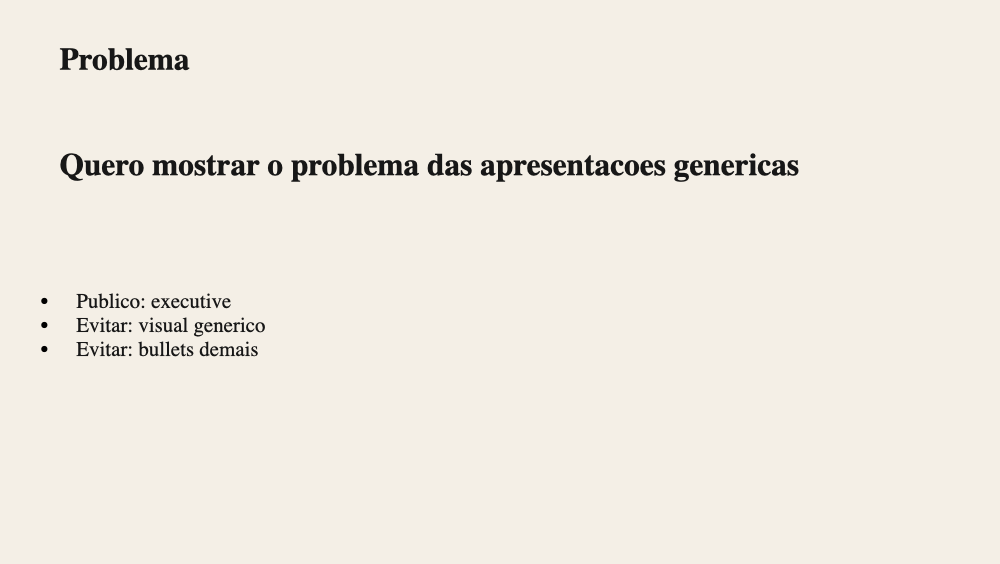
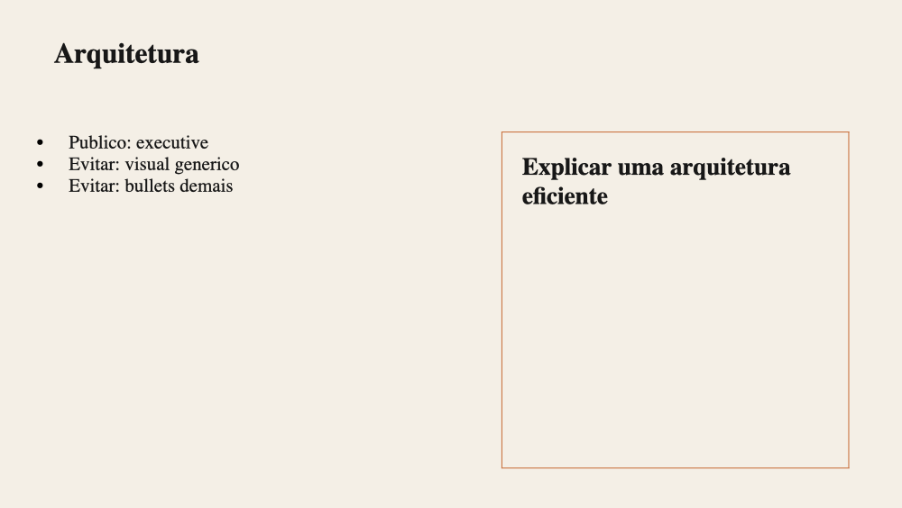
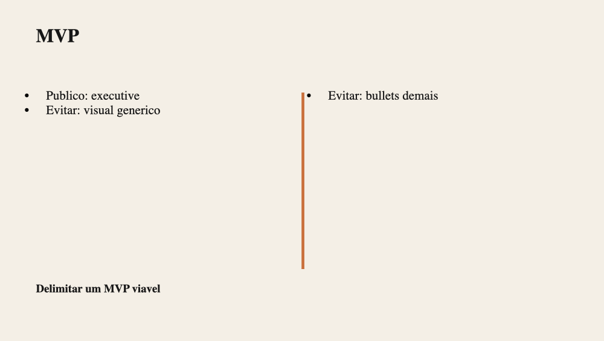
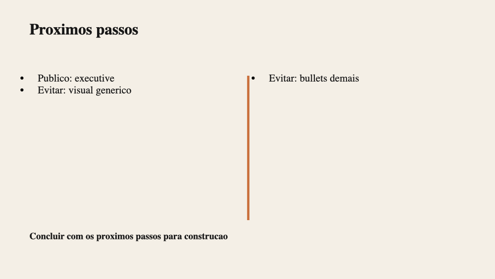
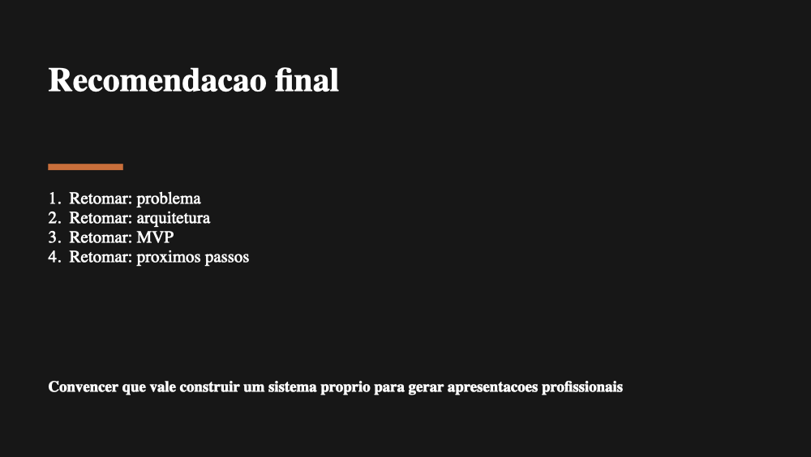
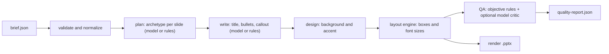

# ppxt-compiler

Compiles a brief into a `.pptx`. An LLM decides intent, structure and copy; a deterministic engine decides layout and coordinates; a rubric of objective rules checks the result.

The idea behind it: models are good at what to say and bad at where to put it. So the model never touches positions, sizes or colors. It returns structured content, and plain code turns that into slides and then tests the slides.

| | | |
|:--:|:--:|:--:|
|  |  |  |
|  |  |  |

*The sample deck, generated offline. The copy is placeholder text by design (see [Status](#status)); the point of the picture is the layouts. Rendered with macOS Quick Look, which falls back to a serif font because Aptos is not installed.*

## How it works



Planning and writing each have a model call and a deterministic fallback. Without an API key, when a call fails, or when the model's answer has the wrong shape, the pipeline uses the fallback for that step only and records why in the manifest. The critic is optional and sits on top of the objective QA rules, which always run.

## Run it

```bash
npm install
npm run generate:sample        # offline, no API key needed
npm test                       # 133 tests
```

It writes to `output/generated/<project_id>/`: the `.pptx` (with speaker notes), `artifacts.json` with every intermediate stage, and `quality-report.json`. The CLI also prints each issue and exits non-zero with `--strict` if the verdict is not `ready`.

To use the model, export `OPENAI_API_KEY` (and optionally `OPENAI_MODEL`) before running; see `.env.example`. The process reads environment variables, so a `.env` file alone is not loaded.

## Design decisions

- **The layout is data, and everything reads the same data.** `layout.ts` turns slide content into positioned elements for one of eight archetypes. The renderer draws exactly those elements, and the QA rules inspect exactly those elements, so a check can never disagree with what is drawn.
- **Fonts fit by construction.** Each element has a ladder of sizes and the layout picks the largest one whose estimated text height fits the box. Overflow is only reported when even the smallest size does not fit.
- **Colors are resolved in one place** (`style.ts`). Text color is the more readable of the theme's text colors on the actual background, and the contrast rule checks the same value.
- **Model output is untrusted.** Every answer goes through `validate.ts`: wrong shape, unknown archetype, duplicate slide ids or non-string bullets are rejected and that step falls back. Content that is merely too long is kept and left for the QA rules to flag.
- **The critic can add problems, never remove them.** The model's slide review is merged with the objective result: issues are unioned, the score is the lower one. A model that ignores the bullet limit and then approves its own work is still flagged.
- **Prompt contracts and QA share one set of limits** (`limits.ts`): the writer is told "at most 4 bullets" with the same constant the rule enforces.
- **Every model call leaves a trace**: prompt id and version, model, whether the output was used, why not, and latency.

## Quality rules

From [`docs/05-slide-quality-rubric.md`](docs/05-slide-quality-rubric.md), implemented in [`src/core/qa.ts`](src/core/qa.ts):

| Code | Severity | Checks |
|---|---|---|
| `MISSING_TITLE` | high | slide has a title |
| `TEXT_OVERFLOW` | high | estimated text height fits its box |
| `LOW_CONTRAST` | high | WCAG contrast: 4.5:1, or 3:1 for large text |
| `OPENING_NOT_DISTINCT` | high | first slide is a hero statement (deck) |
| `TITLE_TOO_LONG` | medium | title up to 72 characters |
| `TOO_MANY_BULLETS` | medium | at most 4 bullets |
| `TEXT_TOO_SMALL` | medium | at least 12 pt |
| `LAYOUT_REPEATED` | medium | no archetype more than twice in a row (deck) |
| `BULLET_TOO_LONG` | low | bullet up to 90 characters |

A slide scores 5 minus 2, 1 or 0.5 per high, medium or low issue. The deck is `ready` when the average is at least 4, no slide fails and there is no high-severity deck issue. Judgement calls such as "does the title state the thesis" are left to the model critic.

## Tests

133 tests, no network. The core is a catalog of known-bad slides, each asserting the exact issue code it must produce, plus layout invariants for every archetype (inside the slide, no overlapping text, readable size), the WCAG reference values, the guardrails on malformed model output, and an end-to-end run that opens the `.pptx` and counts slides and notes. The model path is tested by injecting a fake client, so the fallbacks and the merge rule are covered without an API key. CI runs typecheck, the suite and a `--strict` run of the sample.

## Status

Early, and honest about it.

- **Works:** the pipeline end to end, the eight archetype layouts, the QA rules, the guardrails, the tests.
- **Deterministic copy is placeholder text.** The offline writer builds bullets from the brief (audience, things to avoid) and quotes the script. It exists so layout, render and QA run in CI. Real copy needs the model.
- **The live API path has not been exercised in CI.** It is covered with an injected client; `OpenAIClient` itself is thin and untested against the real service in this repo.
- **Text fit is a heuristic** (average glyph about half an em), not font metrics, so estimates are close but not exact.
- **Rendering was checked by eye in macOS Quick Look**, not in PowerPoint, Keynote or LibreOffice.
- **Not built yet:** images and charts, more than one theme, partial re-render of a single slide.

The original design notes, in Portuguese, are in [`docs/`](docs/).

## Changelog

**0.2.0**
- The renderer used to draw every slide with the same layout and ignore the planned archetypes. It now draws the layout engine's output.
- The offline writer produced titles like "problema deve reforcar o objetivo central" and a fixed sentence in every side panel. Fixed.
- The old QA had three checks and gave its own output 4/5 although every slide shared one layout and the opening title was 99 characters long. It now implements the rubric's rules.
- A model answer used to replace the objective QA result. It is now merged.
- Malformed model JSON could crash the pipeline with a `TypeError`. It is now validated and falls back per step.
- Added tests, CI, speaker notes in the `.pptx`, and `tsx` in place of the experimental `ts-node` loader.
